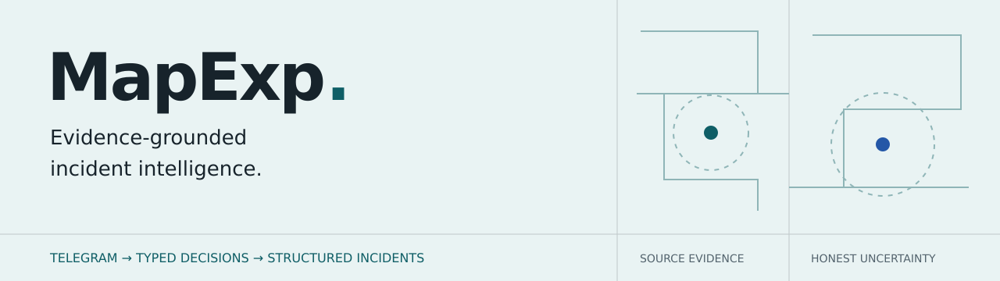
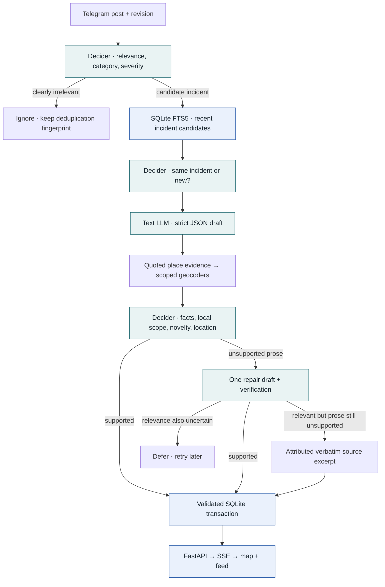
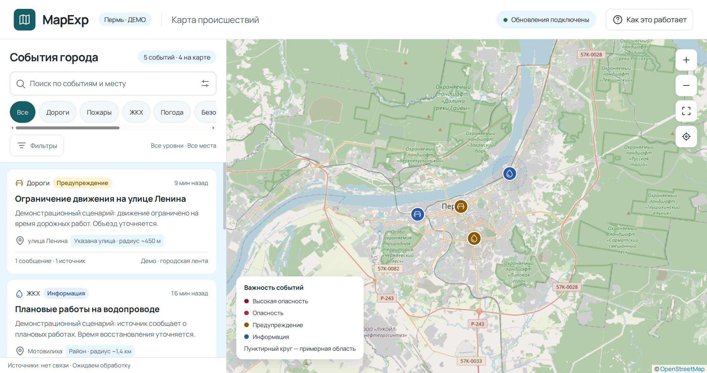
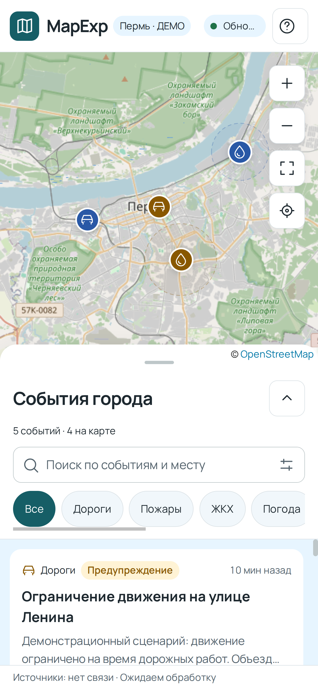
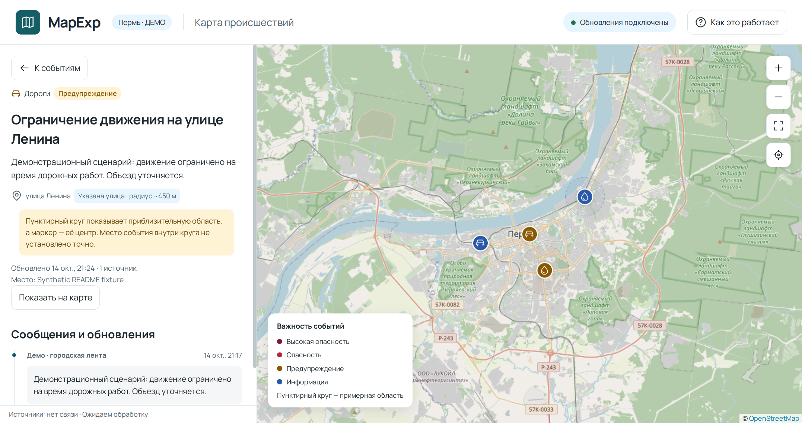
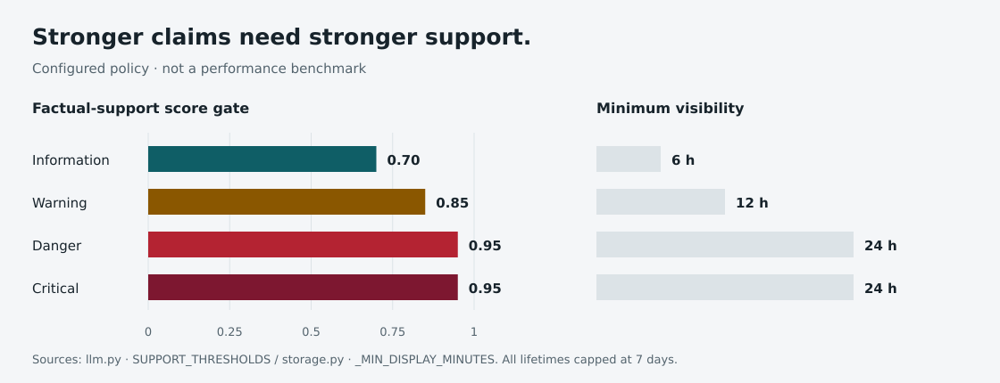
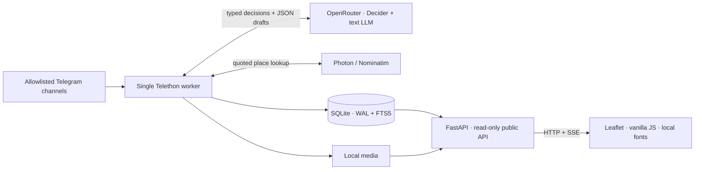

<p align="center">
  
</p>

<p align="center">
  <strong>Local reports. Structured decisions. A map that keeps its evidence.</strong><br>
  An LLM-powered incident intelligence service for Perm, Russia.
</p>

<p align="center">
  <a href="https://mapexp.2-26-150-51.sslip.io">Live map</a> ·
  <a href="#the-llm-pipeline">LLM pipeline</a> ·
  <a href="#inside-the-product">Screenshots</a> ·
  <a href="#decision-policy">Decision policy</a> ·
  <a href="#run-it-locally">Quick start</a> ·
  <a href="docs/OPERATIONS.md">Operations</a>
</p>

<p align="center">
  
  
  
  
</p>

## From noisy posts to readable incidents

MapExp reads an allowlist of Telegram channels, identifies concrete local incidents, groups reports about the same event, and writes short, attributed summaries. Readers get a live map and searchable feed, with the original messages, edits, comments, and available media behind each card.

The core engineering problem is **controlling what a model is allowed to conclude**. A report can be relevant without a known address. A repost can update the feed without extending an incident's lifetime. A confident-looking summary can still contain unsupported facts.

MapExp handles those decisions explicitly, rather than treating generated prose as a finished event.

## The LLM pipeline

Two model roles sit inside a deterministic Python workflow. **Decider** answers bounded questions; a **text LLM** extracts evidence and drafts a structured summary. Application code validates their outputs and commits the result.



| Stage | What happens | Why it matters |
| :--- | :--- | :--- |
| **Triage** | Decider scores local relevance and chooses an incident category and severity. | Plausible preliminary reports can survive; severity describes reported impact, not factual certainty. |
| **Entity resolution** | FTS5 retrieves up to eight active candidates from the last seven days; Decider selects the same physical incident or `new`. | Shared streets or categories alone do not justify merging. |
| **Structured synthesis** | The text model returns an `EventDraft` using strict JSON Schema, then Pydantic validates it. | Required fields, enums, length limits, and forbidden extra fields constrain the output. |
| **Spatial grounding** | An exact source quote must support the location query before geographically scoped Photon/Nominatim lookups run. Decider judges the candidates. | The model never supplies coordinates. Unknown or city-only locations stay in the feed without a marker. |
| **Verification** | Decider checks factual support, local scope, new facts, and location evidence. Unsupported prose gets one repair attempt. | Generation and acceptance are separate decisions, with a bounded fallback. |
| **Persistence** | Python applies validated decisions against the expected post revision. | Stale decisions cannot consume a newer edit; accepted evidence remains available. |

### Bounded retrieval, rather than an autonomous agent

The matching context is deliberately small: lexical retrieval over recent incidents, followed by up to twelve accepted source messages from the selected event. Comments are excluded from that synthesis evidence. There is no embedding index, vector database, fine-tuning pipeline, or model-controlled tool execution.

The implementation uses `perplexity/pplx-decider-v1.2` through the OpenRouter alpha decisions endpoint, plus a configurable text model through its OpenAI-compatible API. The checked-in text-model default is `deepseek/deepseek-v4.1-flash-1017`; availability depends on the provider and account. Both model IDs are environment settings.

### What makes this an ML/LLM engineering project

- **Typed model outputs:** finite choices, validated score distributions, strict generation schemas, and explicit rejection of malformed responses.
- **Evidence-aware generation:** source attribution, uncertainty preservation, exact location quotes, and a repair-or-excerpt fallback.
- **Temporal entity resolution:** new incidents, follow-up reports, source revisions, corrections, and reposts have different consequences.
- **Recall-oriented geography:** plausible place matches produce approximate areas; absent evidence or unusable geometry leaves an unlocated card. Uncertain relevance can defer processing.
- **Observability:** decision audits retain model identity, answers, draft output, token/cost usage when supplied, and call latency.
- **Failure control:** retries respect provider delays; account failures pause processing instead of repeatedly spending requests.

## Inside the product

**Actual application screenshots with synthetic demonstration incidents.** These captures use a separate temporary database, no real Telegram messages or personal media, and no live model calls. The Russian UI is the current product; the demo city header identifies the fixture.



<table>
  <tr>
    <td width="34%" valign="top">
      
    </td>
    <td width="66%" valign="top">
      
      <p><strong>Keep the evidence within reach.</strong> Open an incident to inspect its summary, source history, location precision, and update timestamps. Dashed map circles communicate approximate areas rather than exact incident positions.</p>
      <p>Search and filters work alongside the map. A missing location never removes a report from the feed. Connection status and ingestion freshness are shown separately.</p>
    </td>
  </tr>
</table>

## Decision policy



**These are configured acceptance gates, not accuracy results or calibrated probabilities.** The chart visualizes the current constants in [`llm.py`](llm.py) and [`storage.py`](storage.py).

| Decision | Current gate / behavior |
| :--- | :--- |
| Clearly irrelevant new post | Local-incident score ≤ `0.05`; edits of accepted evidence still proceed through synthesis. |
| Merge with an existing incident | Selected option score ≥ `0.90` and confidence ≥ `0.80`. |
| Publish generated prose | Support score ≥ `0.70` / `0.85` / `0.95`, depending on severity. |
| Accept a location candidate | Grounding score ≥ `0.35`; prefer a unique quoted full-address match, otherwise use a model option ≥ `0.35` or a place-name match ≥ `0.60` (`0.45` for partial intersection/multiple-area clues). Uncertainty expands the mapped area. |
| Extend display lifetime | New-facts score ≥ `0.90`; reposting old facts does not renew it. |
| Display lifetime | At least 6 / 12 / 24 hours by severity, capped at seven days. |

Geographic mapping favors recall: uncertain coordinates are shown as approximate areas rather than silently dropped. [Mapping policy and reprocessing](docs/MAPPING.md). Location precision cannot exceed the source clue or geocoder result. The uncertainty radius incorporates geographic extent and model uncertainty; it is **not** a calibrated containment interval. `location_confidence` is a model score, not incident truth probability. Message counts represent related posts, not independent confirmations.

### Evaluation, honestly scoped

The repository includes offline tests with temporary databases and mocked model/geocoder responses. They exercise parsing, schema validation, evidence grounding, merging, repost behavior, revisions, retries, persistence, and public API behavior.

Local development also used small provider-backed calibration experiments. Those are diagnostic probes, not a held-out benchmark; private evidence archives are excluded from this repository. No general accuracy, precision/recall, latency, or cost claim is made here. The policy chart is intentionally a configuration visualization.

For a meaningful next evaluation, label independent examples of relevance, event identity, factual support, novelty, and location correctness; split incidents across train/calibration/test boundaries; then measure each stage and end-to-end behavior separately.

## A compact service architecture



Two processes, one database, no frontend build step. The worker owns ingestion, retries, expiry, and media cleanup. HTTP reads do not mutate event history. A file lock prevents concurrent workers against the same database.

| File | Responsibility |
| :--- | :--- |
| [`llm.py`](llm.py) | Prompts, typed decisions, structured drafts, verification, location acceptance. |
| [`geocode.py`](geocode.py) | Scoped geographic lookup, candidate normalization, caching, precision. |
| [`storage.py`](storage.py) | SQLite schema, retrieval, revisions, accepted evidence, expiry, audits. |
| [`ingest.py`](ingest.py) / [`pipeline.py`](pipeline.py) | Telegram ingestion, polling, backfill, scheduling, processing. |
| [`web.py`](web.py) / [`static/`](static/) | Public API, SSE, media delivery, responsive map and feed. |
| [`tests/`](tests/) | Isolated backend regression checks; browser helper tests live in `static/ui.test.mjs`. |

## Hosting and CI/CD

The application runs on an Ubuntu VPS, with GitHub Actions testing each update and deploying tested container images from GHCR. SQLite, source configuration, media, provider keys and Telegram sessions persist outside the image. See [deployment and recovery](docs/DEPLOYMENT.md), [delivery scaling](docs/SCALING.md), and [rendering](docs/RENDERING.md).

## Run it locally

Requires **Python 3.11+**, Telegram API credentials and an **already authorized Telethon user session** for ingestion, plus an OpenRouter key with access to the configured models. The web interface can run before ingestion is configured.

```bash
git clone https://github.com/ashromanov/mapexp.git
cd mapexp
python -m venv .venv
.venv/bin/python -m pip install -r requirements.txt
cp .env.example .env
cp sources.json.example sources.json
```

Edit `.env` and `sources.json`. Use the correct city timezone (`Asia/Yekaterinburg` for Perm), set an honest operator contact in `GEOCODER_USER_AGENT`, and point `TG_SESSION` at your authorized session. The example source list is a template; replace it with your intended allowlist.

```bash
# Terminal 1: web UI and API
.venv/bin/python -m uvicorn web:app --host 127.0.0.1 --port 8010

# Terminal 2: ingest recent posts and watch for updates
.venv/bin/python ingest.py --watch --recent-hours 36
```

Open **http://127.0.0.1:8010**. See [operations](docs/OPERATIONS.md) for Docker, session configuration, backups, API routes, and SSE behavior.

### Checks

```bash
.venv/bin/python selftest.py
node static/ui.test.mjs
.venv/bin/python -m compileall -q settings.py storage.py geocode.py llm.py pipeline.py ingest.py web.py
```

These checks do not contact live Telegram/OpenRouter or verify production deployment.

## Boundaries

MapExp summarizes source reports; it is not an emergency dispatch service or an independent verifier of incident truth. Source content is treated as untrusted evidence, and models have no SQL, filesystem, Telegram sending, or publication tools. Final writes are application-controlled.

Secrets, Telegram sessions, source configuration, runtime databases, media archives, local experiment evidence, and design export bundles are excluded from version control. Public incident data and screenshots still need deliberate curation before sharing.
